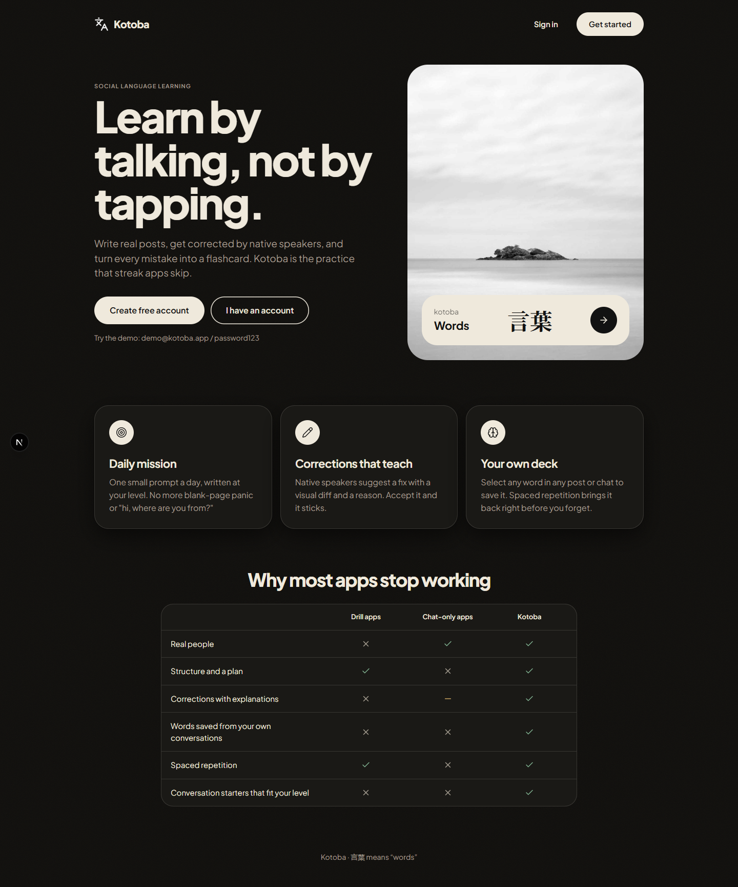
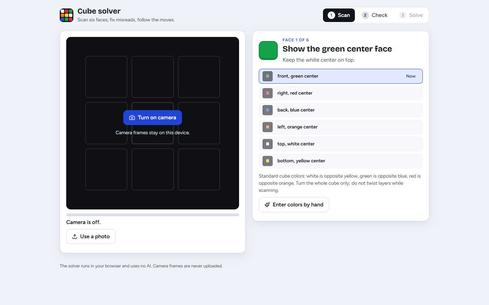

# Pluffy

**One file in. A whole application out.**

Pluffy is a place where an app starts as a single file and grows into a complete, working system: database, backend, web pages, mobile screens and a desktop shell, all from the same source. Make yourself at home.

---

## The idea

Most projects begin with a long afternoon of wiring things together. Pluffy skips that part.

You describe what you want in one file called a **tatemono** (建物, "building" in Japanese). It holds the whole blueprint: the tables, the API, the login, the pages, the look and feel. The engine watches that file and builds everything around it, then rebuilds whenever you save.

Every tatemono is its own small world. It gets its own database, its own users, its own routes and its own pages. Nothing is shared, so you can add one, change one or delete one without disturbing the others.

---

## What lives inside

**One description, many places to run it.**

- **Web:** Next.js, React + Vite, TanStack Start, Astro, or React with Inertia
- **Mobile:** Expo, bare React Native, or Lynx
- **Desktop:** Tauri or Electron
- **Games:** Godot 4 and Unity projects generated from dedicated game DSLs
- **Backend:** Laravel (PHP), Express (TypeScript), FastAPI (Python), Spring Boot (Java), ASP.NET Core (C#), Go, or Rust
- **Database:** SQLite (a file per tatemono) or PostgreSQL (a database per tatemono)

Pick the stack you like, and the same tatemono runs on it.

**The things apps keep needing, already handled.**

Login, real-time updates, notifications, email, background jobs, scheduling, uploads, roles and permissions, and error pages can all be described right inside a tatemono. Some backends are further along than others, and they're all growing.

**A way out when you're done.**

When a tatemono is ready, export it as a standalone project and take it anywhere.
You can also export a dedicated Godot 4 or Unity game Tatemono as an isolated
game project.

---

## Meet the tatemonos

The `tatemonos/` folder is a small gallery of what Pluffy has built so far: café and portfolio sites, a payroll system, a queue manager, a geofenced time clock, a social language-learning app called Kotoba, and an AI chat studio.

They're also the best way to learn the language. Open any `core.tsx` and you'll see how a whole app reads in one place.

### Screenshots

The latest web `index.png` screenshot for each Tatemono is added here
automatically when `npm run shots -- --module=<name>` completes. To rebuild the
index from web screenshots already in `Shots/web/`, run
`npm run shots -- --update-readme`.

<!-- TATEMONO_SHOTS:START -->
<table>
<tr><td align="center"><a href="./tatemonos/kotoba/core.tsx"> <strong>kotoba</strong></a></td><td align="center"><a href="./tatemonos/rubik-solver/core.tsx"> <strong>rubik-solver</strong></a></td></tr>
</table>
<!-- TATEMONO_SHOTS:END -->

---

## The AI side

Pluffy has a brain too. A fine-tuned model learns the tatemono language and can write one from a plain description of an app. Around it there is:

- a chat window for talking to it
- a small web page, so you can do the same from a browser
- a second-opinion reviewer that can read the whole project
- a scanner that turns the tatemonos themselves into training data

It's bring-your-own-model: point Pluffy at a model server, such as a local one or a Colab tunnel, and it does the rest.

---

## Made with Pluffy

V0 ARKZEN
- [hw-coffee](https://hw-coffee.vercel.app/)
- [lain098](https://lain098.vercel.app/)
- [ethereane](https://ethereane.vercel.app/)
- [ethan-pool](https://ethan-pool.vercel.app/)
- [cafe-teresita](https://cafe-teresita.vercel.app/)
- [shan-shan](https://shan-shan-eight.vercel.app/)

V1
- [Kotoba](https://kotoba-khaki.vercel.app/)
- [Rubik-Solver](https://rubik-solver-gamma.vercel.app/)

As the engine and its AI improve, so does the output.

---

Explore the [tatemono examples](./tatemonos/) or browse the [language reference](./PLUFF_GUIDELINES_v14.md).

---

## About

Pluffy is made by **Mizumi**, an independent developer and digital artist. It's a personal project that keeps growing, so some corners are newer than others. Feedback and curiosity are always welcome.

Thanks for stopping by.